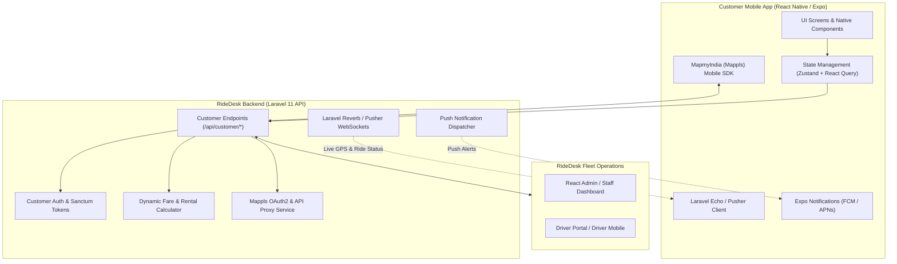

# RideDesk Customer Mobile App - Development Plan & Blueprint

> **Target Platform:** Cross-Platform Mobile Application (Android & iOS)  
> **Ecosystem:** RideDesk Fleet Operations Platform  
> **Status:** Planning & Architectural Specification  
> **Target Mobile Stack:** React Native (Expo SDK 51+) / TypeScript  
> **Target Backend Stack:** Laravel 11 API (Sanctum) + Laravel Reverb / Pusher + FCM  
> **Map Engine:** MapmyIndia (Mappls) Maps SDK & REST APIs (eLoc, AutoSuggest, Routing)  

---

## 1. Executive Summary & Vision

RideDesk is currently an enterprise fleet and driver operations command center powered by a **Laravel 11 REST API** and a **React 18 / Vite SPA** administration dashboard.

This blueprint details the architecture, roadmap, API requirements, and technical phases for developing the official **RideDesk Customer Mobile Application**. The app allows passengers and corporate clients to book on-demand rides, schedule daily/hourly rentals, track their assigned driver and vehicle in real time on a live map powered by **MapmyIndia (Mappls)**, pay securely via UPI/Cards/Cash, and manage rental invoices.

---

## 2. High-Level System Architecture



---

## 3. Map Engine Decision: MapmyIndia (Mappls) vs. Google Maps

### 3.1 Architectural Evaluation Matrix

| Evaluation Metric | MapmyIndia (Mappls) | Google Maps Platform | RideDesk Decision |
|---|---|---|:---:|
| **Pricing & Cost at Scale** | **Billed in INR**, predictable enterprise slabs; ~50% to 70% cheaper than Google | **Billed in USD**, pay-per-request can quickly surge to thousands of dollars/month | 🏆 **MapmyIndia** |
| **Doorstep & Address Accuracy (India)** | House numbers, gali/lane level, society gates, sub-localities, and village roads | Good for commercial POIs, but often drops pins on general streets rather than exact gates | 🏆 **MapmyIndia** |
| **Digital Address Pin** | **eLoc / Mappls Pin** (6-character digital doorstep pin code for exact pickup/drop) | Plus Codes (rarely adopted by everyday Indian taxi passengers) | 🏆 **MapmyIndia** |
| **Live Traffic & ETA** | Good in Tier 1 and Tier 2 cities; expanding real-time corridor coverage | Industry-leading due to massive Android sensor base | **Google Maps** |
| **Toll & Highway Rules** | **Built-in Toll Calculation & Commercial Vehicle Rules** (Flyovers, no-entry zones) | General toll indicators, less fine-tuned for commercial Indian taxi routes | 🏆 **MapmyIndia** |
| **Mobile Integration** | Uses MapLibre GL engine / Mappls Native SDK; OAuth 2.0 backend token rotation | Standard `react-native-maps` turnkey setup with static API key | **Google Maps** |
| **Data Sovereignty** | **100% Indian Data Sovereignty** (MeitY & geospatial guideline compliant) | Hosted on foreign cloud infrastructure | 🏆 **MapmyIndia** |

### 3.2 Why MapmyIndia was Selected for RideDesk
1. **Dramatic Cost Reduction:** Google Maps charges ~$2.83 to $17 per 1,000 Autocomplete calls and ~$5 to $10 per 1,000 Directions calls in USD. At 1,000+ daily rides, Google Maps bills can wipe out operational margins. MapmyIndia delivers high-volume Indian requests at a fraction of the cost in INR.
2. **Doorstep Precision:** MapmyIndia has mapped over 3 crore digital addresses with exact house and apartment gate coordinates. Drivers are routed to the specific building gate rather than the perimeter wall.
3. **eLoc Code Sharing:** Passengers can simply enter or share an eLoc (e.g., `123ABC`) to instantly pinpoint pickup without typing out long addresses.
4. **Backend Proxy Security:** MapmyIndia OAuth 2.0 tokens (`Client ID` and `Client Secret`) will be managed securely inside `backend-laravel/app/Services/MapplsService.php`. The mobile app calls cached proxy endpoints, preventing API abuse and credential exposure.

---

## 4. Technology Stack & Tooling

| Component | Selected Technology | Purpose & Rationale |
|---|---|---|
| **Framework** | **React Native (Expo SDK 51+)** | Fast cross-platform compilation (iOS & Android). Leverages team's React expertise from `frontend-react`. |
| **Language** | **TypeScript** | Strict typing, robust data contracts with Laravel API resources. |
| **Styling & Design** | **NativeWind (Tailwind CSS for React Native)** | Consistent, responsive UI system aligned with RideDesk command center styling. |
| **Navigation** | **React Navigation (v6 / Expo Router v3)** | Native stack and bottom tab navigators with smooth screen transitions. |
| **State & Cache** | **Zustand + TanStack React Query** | Lightweight local state (auth, preferences) + automatic cache invalidation and background polling. |
| **Maps & Routing** | **MapmyIndia (Mappls) SDK + Mappls REST APIs** | Doorstep accuracy across India, eLoc digital addresses, cost-effective Indian road and toll data. |
| **Real-time WebSockets** | **Laravel Echo + Pusher / Laravel Reverb** | Real-time driver GPS tracking, status transitions, and instant ride alerts. |
| **Push Notifications** | **Expo Notifications + Firebase Cloud Messaging (FCM)** | Background alerts for booking acceptance, driver arrival, trip completion, and billing. |
| **Secure Storage** | **expo-secure-store** | Encrypted storage for Sanctum Bearer tokens and sensitive user credentials. |
| **Payments** | **Razorpay / Stripe React Native SDK** | Seamless UPI (GPay, PhonePe, Paytm), Credit/Debit cards, NetBanking, and cash. |

---

## 5. Phase-by-Phase Roadmap

### Phase 1: Backend Customer API, Mappls Proxy & Auth Layer
**Priority:** Critical  
**Target:** `backend-laravel/`

- [ ] **Customer Authentication Pipeline:**
  - Create `customers` authentication guard or extend `users` with `role: customer`.
  - Endpoint: `POST /api/customer/auth/send-otp` (SMS verification via Twilio / Fast2SMS).
  - Endpoint: `POST /api/customer/auth/verify-otp` (Issues Sanctum token, returns user profile).
  - Endpoint: `POST /api/customer/auth/login` (Email/password fallback for corporate customers).
  - Endpoint: `GET /api/customer/auth/me` and `PUT /api/customer/auth/profile`.
- [ ] **MapmyIndia (Mappls) Backend Service (`App\Services\MapplsService`):**
  - Manage OAuth 2.0 token generation and caching with `https://outpost.mappls.com/api/security/oauth/token`.
  - Endpoint: `GET /api/customer/places/autosuggest` (Proxies Mappls AutoSuggest with location bias to shield secrets).
  - Endpoint: `GET /api/customer/places/reverse-geocode` (Converts GPS coordinates to doorstep address & eLoc).
- [ ] **Customer Fare Estimation Engine:**
  - Endpoint: `POST /api/customer/estimate-fare`.
  - Query Mappls Distance Matrix & Routing API to obtain exact driving distance, travel duration, and toll tax data.
  - Calculate base fare, per-kilometer rate, per-minute charge, toll/taxes, and surge pricing based on vehicle category (Hatchback, Sedan, SUV, Luxury).
- [ ] **Customer Booking Endpoints:**
  - Endpoint: `POST /api/customer/bookings` (Create instant ride or advance rental booking).
  - Endpoint: `GET /api/customer/bookings/active` (Fetch active trip status, driver details, and live coordinates).
  - Endpoint: `GET /api/customer/bookings/history` (Paginated past trips with download receipt link).
  - Endpoint: `POST /api/customer/bookings/{id}/cancel` (Reason selection + cancellation fee policy).
- [ ] **Driver Availability Endpoint:**
  - Endpoint: `GET /api/customer/nearby-taxis` (Geospatial query for idle vehicles within configured radius).

---

### Phase 2: Mobile Scaffolding & Design System
**Priority:** High  
**Target:** `customer-mobile-app/`

- [ ] Initialize Expo project using TypeScript template (`npx create-expo-app customer-mobile-app --template tabs`).
- [ ] Configure `NativeWind` (Tailwind CSS v3) with RideDesk theme colors:
  - Primary Brand: `#0284c7` (Sky Blue)
  - Dark Surface: `#0f172a` (Slate 900)
  - Card/Borders: `#1e293b` / `#334155`
  - Accent / Status: Success `#10b981`, Warning `#f59e0b`, Danger `#ef4444`.
- [ ] Implement foundational UI components:
  - `Button`, `Input`, `OtpInput`, `Card`, `Modal`, `BottomSheetModal`, `Badge`, `Avatar`.
- [ ] Configure `expo-secure-store` for token retention and Axios interceptors for automatic bearer injection and 401 handling.

---

### Phase 3: Customer Onboarding & Authentication
**Priority:** High  

- [ ] **Splash & Welcome Walkthrough:**
  - 3-step carousel introducing RideDesk on-demand rides, luxury rentals, and transparent billing.
- [ ] **Phone Number & OTP Flow:**
  - Country code picker + 10-digit mobile number input.
  - 6-digit auto-read OTP input screen with countdown resend timer.
- [ ] **Profile Setup:**
  - First Name, Last Name, Email, Emergency Contact, and Corporate Billing info (optional GST/company details).
- [ ] **Permissions Gate:**
  - Seamless permission request screens for Location Services (Always / While In Use) and Push Notifications.

---

### Phase 4: MapmyIndia (Mappls) Vector Map Engine & Ride Discovery
**Priority:** High  

- [ ] **MapmyIndia Vector Map Canvas:**
  - Full-screen native Mappls Map (`mappls-map-react-native` or MapLibre GL with Mappls Indian vector tile styling) centered on customer GPS location.
  - Indian road layer features: flyover indicators, sub-lanes, and local landmarks.
  - Floating controls: Recentering button, Current City / Branch pill, Profile shortcut.
- [ ] **Mappls Search & AutoSuggest:**
  - MapmyIndia AutoSuggest API search bar for "Where to?".
  - Doorstep pinpointing via **Mappls Pin / eLoc** (6-character digital address code).
  - Quick destination chips: *Saved Home*, *Work*, *Recent Trips*.
  - Draggable Pin on map for fine-tuning exact pickup/drop spots with Mappls Reverse Geocoding.
- [ ] **Vehicle Category Carousel (Bottom Sheet):**
  - Horizontal selector showing vehicle classes (e.g., Economy Sedan, Premium SUV, 7-Seater, Luxury).
  - Real-time display of:
    - Estimated pickup time (e.g., `4 min away`).
    - Fixed fare estimate (e.g., `₹450 - ₹500`).
    - Vehicle capacity (seats, bags) and photograph preview.
- [ ] **Booking Mode Selector:**
  - Toggle between **Ride Now** (on-demand dispatch) and **Reserve Later** (scheduled rental with date/time picker).

---

### Phase 5: Booking Lifecycle & Dispatch Handshake
**Priority:** High  

- [ ] **Searching Driver State:**
  - Pulsing radar radar animation while dispatching ride to nearby drivers.
  - Timeout countdown and manual cancellation button.
- [ ] **Driver Assigned Screen:**
  - Slide-up bottom sheet with:
    - Driver photo, name, rating badge (e.g., `★ 4.8`).
    - Vehicle make, model, color, and registration plate badge.
    - 4-digit **Start Ride OTP** (ensures passenger boards correct taxi).
    - Quick action buttons: **Call Driver** (phone dialer), **Message Driver**, and **Cancel Ride**.
- [ ] **Cancellation Flow:**
  - Pre-defined cancellation reason selector (e.g., *Driver too far*, *Booked by mistake*, *Driver requested cash*).
  - Dynamic cancellation fee alert if driver already arrived at pickup.

---

### Phase 6: Real-Time Live Trip Tracking
**Priority:** High  

- [ ] **Live Location Streaming:**
  - Subscribe to private WebSocket channel `booking.{bookingId}` via Laravel Echo.
  - Receive driver GPS latitude/longitude pulses every 3–5 seconds.
- [ ] **Smooth Marker Interpolation:**
  - Smooth car marker rotation and bearing heading adjustment along road coordinates.
  - Render dynamic polyline route using MapmyIndia Routing & Directions API (decoding Mappls polyline geometry).
- [ ] **Ride Progress Milestones:**
  - Status updates:
    1. *Driver heading to pickup*
    2. *Driver has arrived at pickup location*
    3. *Trip started (OTP verified)*
    4. *On trip to destination*
    5. *Arrived at destination*
- [ ] **Safety & SOS Features:**
  - Prominent red **SOS Button** with 1-tap call to local emergency services or RideDesk 24/7 helpline.
  - **Share Live Trip** link via WhatsApp or SMS to friends and family.

---

### Phase 7: Payments, Wallets & Digital Receipts
**Priority:** Medium-High  

- [ ] **Payment Selector:**
  - Support for multiple payment methods:
    - Cash to Driver
    - Razorpay / Stripe (Credit Card, Debit Card, NetBanking)
    - UPI Deep-link (GPay, PhonePe, Paytm)
    - Corporate Office Account (pre-approved billing)
- [ ] **Trip Invoice & Breakdown:**
  - Post-trip summary screen showing:
    - Base fare
    - Distance charged ($km \times \text{rate}$)
    - Waiting time / Toll charges / Tax (GST)
    - Total paid & payment method badge
- [ ] **PDF Invoice Export:**
  - One-click button to download/share official RideDesk PDF receipt.

---

### Phase 8: Ratings, Reviews & Customer Support
**Priority:** Medium  

- [ ] **Driver Rating Modal:**
  - 5-star rating interface displayed automatically upon trip completion.
  - Feedback tag chips: *Polite Driver*, *Clean Taxi*, *Safe Driving*, *AC Working*.
  - Optional tip driver option.
- [ ] **Support & Help Desk:**
  - In-app FAQ & Help Center.
  - Dispute a charge / Report lost item / Report rude driver ticket submission.

---

### Phase 9: Push Notifications & Live Activities
**Priority:** Medium  

- [ ] **FCM & APNs Integration:**
  - Register customer device token (`fcm_token`) with backend upon login.
  - Handle foreground, background, and killed-app notification deep linking.
- [ ] **Notification Triggers:**
  - *Booking Confirmed*
  - *Driver 2 Minutes Away*
  - *Driver Arrived at Pickup*
  - *Trip Receipt Available*
  - *Promotional Offers & Festive Discounts*
- [ ] **iOS Live Activities / Android Dynamic Notification:**
  - Persistent lock-screen widget displaying real-time ETA and driver plate during an active trip.

---

### Phase 10: Security, Testing & Store Deployment
**Priority:** High  

- [ ] **Security Hardening:**
  - API rate limiting (`throttle:60,1`) on booking and auth endpoints.
  - SSL certificate pinning for mobile-to-API communication.
  - Strict input sanitization and token expiration handling.
- [ ] **Automated Testing:**
  - Unit tests for fare calculator and utility functions (Jest).
  - Component integration tests (React Native Testing Library).
  - End-to-End ride booking test flow using Maestro / Detox.
- [ ] **Store Deployment Pipeline:**
  - Fastlane / Expo Application Services (EAS Build & EAS Submit).
  - Google Play Console requirements: Target API 34+, 64-bit compliance, location privacy declaration.
  - Apple App Store requirements: App Tracking Transparency (ATT), Apple Sign-In support if social login enabled, privacy nutrition labels.

---

## 6. Customer Database Schema Changes

To accommodate customers in `backend-laravel`, the following schema additions are scheduled:

```sql
-- Migration: Add auth & device tokens to customers table
ALTER TABLE customers ADD COLUMN password VARCHAR(255) NULL AFTER email;
ALTER TABLE customers ADD COLUMN otp_code VARCHAR(6) NULL;
ALTER TABLE customers ADD COLUMN otp_expires_at TIMESTAMP NULL;
ALTER TABLE customers ADD COLUMN fcm_token VARCHAR(500) NULL;
ALTER TABLE customers ADD COLUMN profile_photo_path VARCHAR(255) NULL;
ALTER TABLE customers ADD COLUMN status ENUM('active', 'suspended') DEFAULT 'active';

-- Migration: Add GPS coordinates & live tracking to bookings table
ALTER TABLE bookings ADD COLUMN pickup_lat DECIMAL(10, 8) NULL AFTER pickup_location;
ALTER TABLE bookings ADD COLUMN pickup_lng DECIMAL(11, 8) NULL AFTER pickup_lat;
ALTER TABLE bookings ADD COLUMN pickup_eloc VARCHAR(10) NULL AFTER pickup_lng;
ALTER TABLE bookings ADD COLUMN dropoff_lat DECIMAL(10, 8) NULL AFTER dropoff_location;
ALTER TABLE bookings ADD COLUMN dropoff_lng DECIMAL(11, 8) NULL AFTER dropoff_lat;
ALTER TABLE bookings ADD COLUMN dropoff_eloc VARCHAR(10) NULL AFTER dropoff_lng;
ALTER TABLE bookings ADD COLUMN start_otp VARCHAR(4) NULL AFTER status;
ALTER TABLE bookings ADD COLUMN payment_method ENUM('cash', 'card', 'upi', 'wallet') DEFAULT 'cash';
ALTER TABLE bookings ADD COLUMN payment_status ENUM('pending', 'paid', 'refunded') DEFAULT 'pending';
ALTER TABLE bookings ADD COLUMN rating_stars TINYINT NULL;
ALTER TABLE bookings ADD COLUMN rating_feedback TEXT NULL;
```

---

## 7. Execution Timeline & Milestones

| Sprint | Duration | Deliverables |
|---|---|---|
| **Sprint 1** | Week 1 - 2 | Backend Customer Auth, OTP verification, Database migrations, Customer Sanctum tokens |
| **Sprint 2** | Week 3 - 4 | Mobile app initialization (Expo + TypeScript + NativeWind), Auth & Profile screens |
| **Sprint 3** | Week 5 - 6 | MapmyIndia (Mappls) Vector Map & AutoSuggest integration, eLoc support, Vehicle category selector, Fare calculation |
| **Sprint 4** | Week 7 - 8 | Booking creation flow, Driver assignment handshake, Start Ride OTP verification |
| **Sprint 5** | Week 9 - 10 | Real-time tracking (Pusher/Reverb), driver vehicle marker movement on map, SOS button |
| **Sprint 6** | Week 11 - 12 | Payment gateway (Razorpay/Stripe/UPI), Invoices, Ratings & Feedback modal |
| **Sprint 7** | Week 13 - 14 | Push notifications (FCM), End-to-End QA testing, EAS build setup, Play Store & App Store submission |

---

> *Document created for RideDesk taxi rental mobile app ecosystem. Maintained alongside `plan.md` and `feature.md`.*
